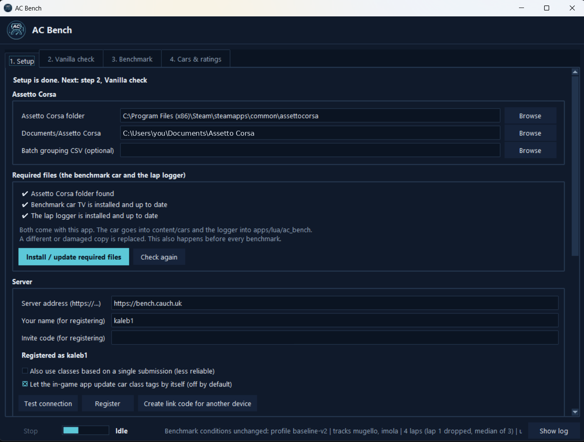
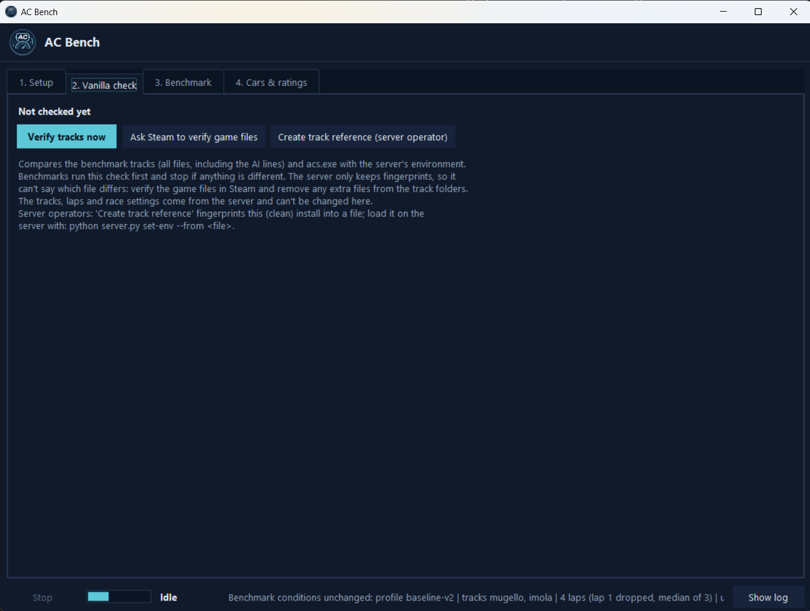
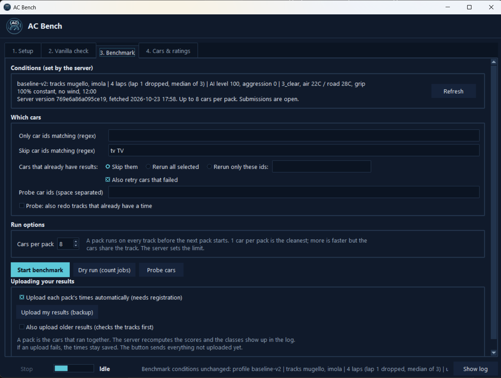
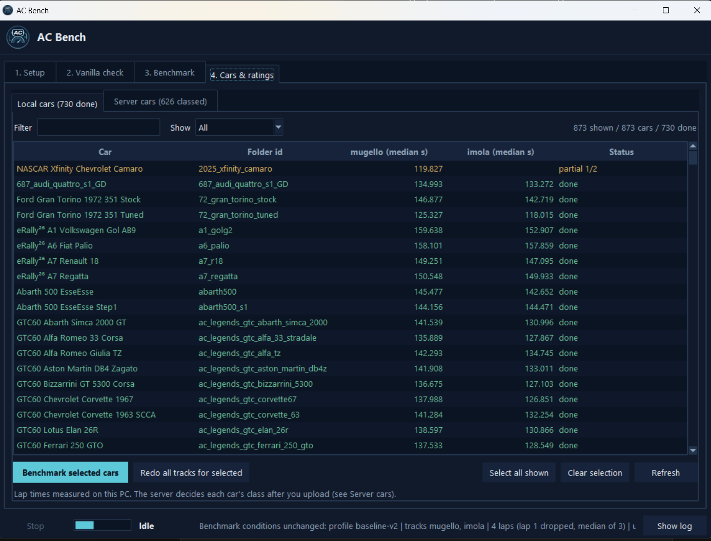
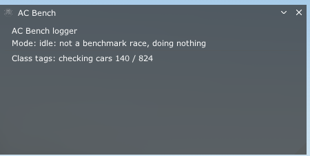
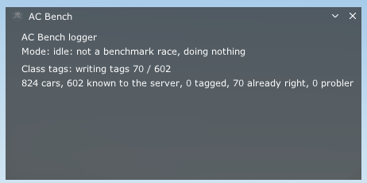

<p align="center">
  
</p>

<h1 align="center">AC Bench Desktop</h1>

<p align="center">
  Benchmark your Assetto Corsa cars and see how they stack up against everyone else's.
</p>

---

The desktop app for benchmarking Assetto Corsa car mods against a fixed baseline. It has a Windows GUI, the benchmark
runner, an in-game Lua logger and the local result handling.

## How it works

Every car is benchmarked under the same conditions, and the server decides what they are: the tracks, the number of
laps, the AI settings, the weather and the rest. The app fetches them from the server before every benchmark, vanilla
check and upload, and none of it can be changed here. A car's score on a track comes from the median of its timed laps
(lap 1 is a standing start and is dropped).

Because everything is fixed by the server, times from different cars and different PCs can be compared directly.

## Quick start

Grab `AC-Bench.exe` from the [`dev-latest` release](../../releases/tag/dev-latest) and run it. Nothing needs installing.
(See [Portable exe](#portable-exe) for how it's built.)

To run from source instead, use `run_gui.bat` on Windows, or:

```bash
python ac_bench_gui.py
```

## Workflow

The tabs go in the order you use them. The app opens on step 2 when setup is complete, and on step 1 otherwise. The bar
along the bottom is always there: **Stop**, a progress bar, the current state, the server's conditions and **Show log**.

### 1. Setup

<p align="center">
  
</p>

- **Assetto Corsa folders:** the game folder and your Documents/Assetto Corsa folder. There's also an optional batch grouping CSV.
- **Required files:** the benchmark car and the Lua logger. The checklist shows what's installed and up to date.
  *Install / update required files* copies both into Assetto Corsa and replaces a different or damaged copy. This also
  happens automatically before every benchmark.
- **Server:** the server address, your name and an invite code, then **Register**. *Test connection* checks that the
  server answers, and *Create link code for another device* is for [using the same account elsewhere](#same-account-on-another-device).
- Two options sit under the registration: whether to also use classes that rest on a single submission (less
  reliable), and whether the in-game app may [update car class tags by itself](#tags-from-inside-the-game) (off by default).

### 2. Vanilla check

<p align="center">
  
</p>

Compares the benchmark tracks (every file, including the AI lines) and `acs.exe` with the server's environment.
Benchmarks run this check first and stop if anything differs. The server only keeps fingerprints, so it can't tell you
which file is different. If the check fails, verify the game files in Steam (**Ask Steam to verify game files**) and
remove any extra files from the track folders.

**Create track reference (server operator)** is for whoever runs the server, see
[Creating the track reference](#creating-the-track-reference-server-operator).

### 3. Benchmark

<p align="center">
  
</p>

- **Conditions:** what the server has set (tracks, laps, AI level, weather, grip and so on). They're read-only here.
  *Refresh* fetches them again.
- **Which cars:** filters for what to run. A skip pattern like `tv TV` keeps the bundled TV car out. For cars that already
  have results you can skip them, rerun everything selected, or rerun only certain ids, and failed cars can be retried
  on the way. The probe fields are for [rebenchmarking](#rebenchmarking) specific cars.
- **Run options:** *Cars per pack*. A pack runs on every track before the next pack starts. One car per pack is the
  cleanest because the cars don't share the track. Bigger packs are faster. The server sets the upper limit.
- **Buttons:** *Start benchmark*, *Dry run* (only counts the jobs) and *Probe cars*.
- **Uploading:** each pack's times go to the server as soon as its cars finish, if you're registered. *Upload my
  results (backup)* sends everything that hasn't been uploaded yet, see [Uploading results](#uploading-results).

### 4. Cars & ratings

<p align="center">
  
</p>

Two lists. **Local cars** shows the lap times measured on this PC, with a status per car: done, partial (some tracks
have no valid time yet, shown in amber) or failed. **Server cars** shows the classes the server has given your
installed cars. The local list can be filtered by name and by status.

Select cars and press **Benchmark selected cars** to run them (only on the tracks where they have no valid time yet),
or **Redo all tracks for selected**. See [Rebenchmarking](#rebenchmarking).
**Apply server classes as tags** and **Benchmark cars missing from server** (installed cars the server has no class for
yet) are on this tab as well.

## In-game app

The Lua app shows up in Assetto Corsa's app bar with the AC Bench icon. During a benchmark race it logs the AI lap times
for the app. The rest of the time it does nothing, apart from keeping car class tags up to date if you turned that on.

<p align="center">
  
  &nbsp;
  
</p>

The window shows the mode (idle outside benchmark races) and how far the tag sync is: first it checks your cars, then
it writes the tags, and the last line counts the cars, how many the server knows, and how many were tagged, already
right or had a problem. More on that under [Tags from inside the game](#tags-from-inside-the-game).

## What's in here

- `ac_bench_gui.py`: the GUI, for benchmarking, uploading and tagging
- `ac_lap_bench.py`, `ac_baseline.py`: build and run the fixed-baseline races
- `ac_carid.py`, `ac_car_classifier.py`, `ac_rating.py`: identify cars by physics hash, read car data, rate results
- `ac_track_check.py`: checks the vanilla tracks and `acs.exe`
- `ac_cloud.py`, `ac_live.py`: talk to the server (upload, live car lookups)
- `ac_theme.py`: the colors, window icon and logo
- `apps/lua/ac_bench/`: the in-game Lua app. It logs AI lap times during benchmark races. Otherwise it keeps the
  `#Pride-<class>` car tags up to date (`class_sync.lua`, set up by the `config.json` the app writes during
  *Install required files*). Its in-game icon is `icon.png`, a white version of the logo (AC tints app icons itself).
- `branding/`: the logo (`ac-bench.ico` for the exe and window, PNGs for the window header and this README)
- `docs/screenshots/`: the screenshots in this README
- `bundled_car/`: the TV Car by EmilioGQ (https://www.overtake.gg/downloads/tv-car.45108/), which every run drives so
  results stay consistent between installs. It's never benchmarked itself, in any mode, and is never listed or tagged.

## Look and feel

A dark navy theme taken from the logo. Surfaces are three close shades of the navy, borders are hairlines, and text is
off-white with two greys for hierarchy. The logo's cyan is only used for the main action, the selected row and progress,
so it stands out when it shows up. The colors are all defined in `ac_theme.py`. The logo shows in the title bar, the
taskbar, the top of the window and on the exe itself.

| Use | Color |
|-----|-------|
| Window | `#101a2b` |
| Buttons, list headers | `#16233a` |
| Inputs, lists, log | `#0b1422` |
| Hairlines | `#25374f` |
| Accent | `#5cc8d8` |
| Text / muted | `#e6edf5` / `#8fa3b8` |

## The server

Results go to the [AC Bench Server](https://github.com/yiyirob973/AC-Bench-Server), which validates them, combines data
from several users and publishes versioned class tables. The repository has the server setup and backend docs.

The desktop app only measures lap times. It never works out a class itself. **Local cars** shows the times measured on
this PC. After an upload (automatic after each pack, or with the backup button) the server recomputes the scores,
classifies the cars and replies with the class of every car you just uploaded. That reply is printed in the log and then
shows up in **Server cars**.

## Server cars

The Server cars list is read live. Your installed cars are hashed by their physics files (cached in
`car_hash_cache.json`, only changed cars get re-hashed) and just those hashes are sent to `POST /v1/cars/lookup`. It
refreshes when the Cars tab opens (if the data is over a minute old), at start, and with **Refresh**. The ratings are
only kept in memory. This needs a server that has the lookup endpoint.

### Applying tags

**Apply server classes as tags** (or `python ac_live.py tag --server URL --cars-dir "<AC>/content/cars" --apply`) does
its own lookup: it finds the cars installed on this PC, asks the server about only those and writes one `#Pride-<class>`
tag into each car that has a verified class (provisional ones too, if enabled in Settings). The bundled car is skipped.
Nothing is downloaded in bulk and no ratings file is written. `ui_car.json` is backed up first.

### Tags from inside the game

The Lua app can do the same thing on its own. A short while after a race loads it identifies your installed cars, asks
the server about just those and writes the same `#Pride-<class>` tags, using the same backup rule.

- It never runs in online races, or in benchmark races.
- It's built not to be felt. Every frame it gets a small time budget (about 2 ms while you're stopped, 0.5 ms while
  you're moving) and stops as soon as it's used up. Reading and hashing a big file can't be split up, so that happens one
  file at a time with a pause afterwards that is several times as long as the file took. While you're moving it only
  touches small files, and cars with bigger ones wait until you stop. A car with a very large file (over about 768 KB)
  is skipped and counted in the in-game window; **Apply server classes as tags** in the desktop app takes care of those.
  It backs off for a few seconds when a frame takes very long and does nothing while the frame rate is below about 45 fps.
- It waits 45 seconds after the race loads before it starts. The first run over a big collection takes a few minutes
  because every car has to be hashed. After that, only cars that changed are hashed again.
- After a check it doesn't run again for 6 hours. **Check now** in the in-game window runs it right away.
- It's off by default. Tick **Let the in-game app update car class tags by itself** on the Setup tab to turn it on.
  The setting reaches the Lua app through `config.json`, which the app writes when you change the checkbox or the
  server address and when you press *Install / update required files* (the Lua app has to be installed first). With it
  off, **Check now** in the in-game window still runs a check by hand.
- It needs a CSP version that has `ac.checksumSHA256`. If it's missing, the in-game window says so.

## Class labels

Classes are `1A` (top class), `1B` ... `1Z`, then `2A` ... `2Z`, `3A` and so on. Two-letter codes like `AA` aren't used
any more because searching for class "A" matched cars in other classes. Tags look like `#Pride-1A`, `#Pride-1B`, and
applying tags replaces any older `#Pride-` tag (for example `#Pride-A`). The server renames the classes in tables it
already published, so there's nothing to migrate.

## How each race is started

Every race is started with AC's own **Start race** hotkey. There's no other way to start one (no clicking, no
calibration). It's the same command as Content Manager > Settings > Assetto Corsa > Controls > System > Race > *Start
race*, stored in `Documents\Assetto Corsa\cfg\controls.ini` as `[__CM_START_SESSION]` with `KEY=0x7B ; F12`. Content
Manager writes the key as hex plus its name, and the app reads both hex and plain numbers. The hotkey is Ctrl + that key.

- A key you already set is always used and never changed (the log mentions it if AC uses that Ctrl+key for something
  else). F12 is only written when nothing is set. Duplicate `KEY` lines get cleaned up. Only that section is touched, a
  backup is kept (`controls.ini.acbench.bak`), and a dry run never touches the file.
- Custom Shaders Patch handles the hotkey in the game when `extension\config\data_hotkeys_supported.txt` lists
  `__CM_START_SESSION`, so Content Manager doesn't need to be running. The log says which case your install is.
- Under Setup > *Starting each race*, **Set up start hotkey** prints what controls.ini contains and **Test start hotkey**
  presses it once (open AC on the pre-race screen first). *First try after launching AC* is the delay before the first
  press. After that the app presses it every few seconds until the logger reports that the race has started. Restart AC
  after the key changes.

## Uploading results

By default a pack's times are uploaded as soon as its cars have run on every track (a pack is one car when *Cars per
pack* is 1). The server recomputes the scores and replies with each car's class, which is printed in the log. If an
upload fails (offline, rate limit, not registered) the benchmark carries on and the times stay saved. **Upload my
results (backup)** on the Benchmark tab sends everything that hasn't been uploaded yet. Untick *Upload each pack's times
automatically* to upload only with the button. Uploaded results are remembered, so nothing gets sent twice.

Job processes (benchmark, upload and so on) always write UTF-8, so car names with special characters don't crash an
upload or turn into garbage in the log.

## Rebenchmarking

**Benchmark selected cars** redoes the cars you picked, but only on the tracks where they have no valid time yet. A car
that has a time on one track and a failure on the other only reruns the failed one. **Redo all tracks for selected**
does every track. On the command line that's `--probe` (add `--all-tracks` for everything). The *Rerun* options still
redo every track of the cars they apply to.

## Same account on another device

On the device that's already registered: Setup > **Create link code for another device** (or `python ac_cloud.py link`).
On the new device: Setup > **Use the same account on another device**, enter the code and press **Sign in** (or
`python ac_cloud.py login --code=XXXX-XXXX-XXXX`). The code works once and expires after a few minutes. Each device gets its own key
for the same account, saved in its own `cloud_config.json`.

## Creating the track reference (server operator)

The server's reference environment is a digest of every benchmark track folder plus the SHA-256 of `acs.exe`. Make it
from a clean install: Steam > Verify integrity of game files, with no extra files in the track folders.

- GUI: **Vanilla check** tab > **Create track reference (server operator)**, or
- CLI: `python ac_track_check.py create --ac-dir "<AC>" --out track_reference.json`

The track list and profile come from the server's `/v1/conditions`, so no environment is needed yet. Load the file on the
server with `python server.py set-env --from track_reference.json`. Players then verify against it.

## Portable exe

The GitHub workflow `.github/workflows/build.yml` builds `AC-Bench.exe` with **Nuitka**, which compiles the code to a
native program (PyInstaller exes get flagged by antivirus products far more often). It needs `template_race.ini` in the
repo and embeds it together with `bundled_car/`, `apps/lua/ac_bench/` and `branding/`. The exe gets the logo as its file icon
from `branding/ac-bench.ico`.

- By default it builds one file. Every push to `dev` publishes it to the rolling `dev-latest` GitHub Release (direct
  download, with a `.sha256`). The Actions artifact holds the same file, wrapped in a zip because GitHub always does that.
  Start the workflow by hand with **folder** ticked to get a folder build instead (for debugging).
- **Embedded, read-only:** the race template, the benchmark car and the Lua logger are read from inside the exe.
  *Install / update required files* on the Setup tab, and the automatic install before each benchmark, copy them from
  there into Assetto Corsa.
- **Written next to the exe:** settings, `lap_results.json`, `cloud_config.json`, caches and logs. Copy the folder and
  everything comes along. If that folder isn't writable (Program Files, say) the app uses `%LOCALAPPDATA%\AC-Bench`
  instead. Nothing is written to the temporary unpack folder, which is deleted when the app closes.
- **Jobs:** the exe has no separate script files, so the app starts itself with `--ac-run <module>` to run the
  benchmark, upload, vanilla check and tagging as child processes (same window, output in the log).
- **From source** everything works the same (`run_gui.bat` or `python ac_bench_gui.py`). `ac_paths.py` is the one place
  that decides where files live.
- Every build checks the finished program (`--ac-selfcheck`: embedded template, car and Lua logger present, all modules
  importable) and starts a job through `--ac-run` before the artifact is uploaded.

Nuitka cuts the chance of a false positive a lot but can't remove it. A new, unsigned program that few people have
downloaded has no reputation yet. Signing it with a code-signing certificate is what fixes that for good.

## Repository layout

```text
AC-Bench-Desktop/
  README.md
  run_gui.bat
  ac_bench_gui.py
  ac_baseline.py
  ac_carid.py
  ac_car_classifier.py
  ac_cloud.py
  ac_live.py
  ac_input.py
  ac_lap_bench.py
  ac_rating.py
  ac_tag_writer.py
  ac_theme.py
  ac_track_check.py
  branding/
    ac-bench.ico
    ac-bench.png
    header.png
  docs/screenshots/
  apps/lua/ac_bench/
    ac_bench.lua
    class_sync.lua
    manifest.ini
```
